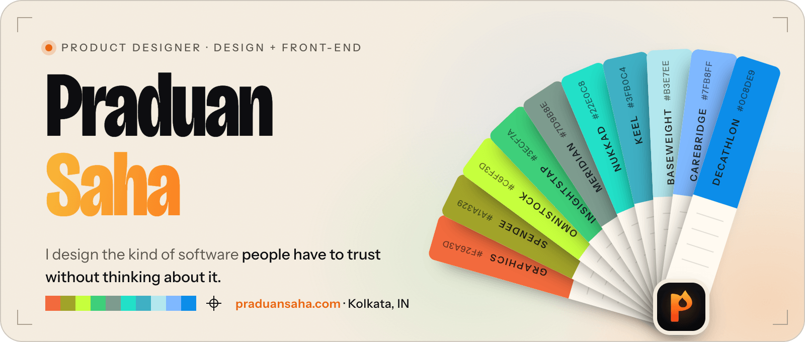
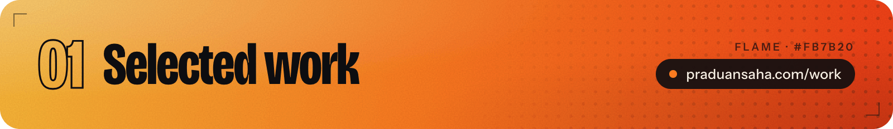
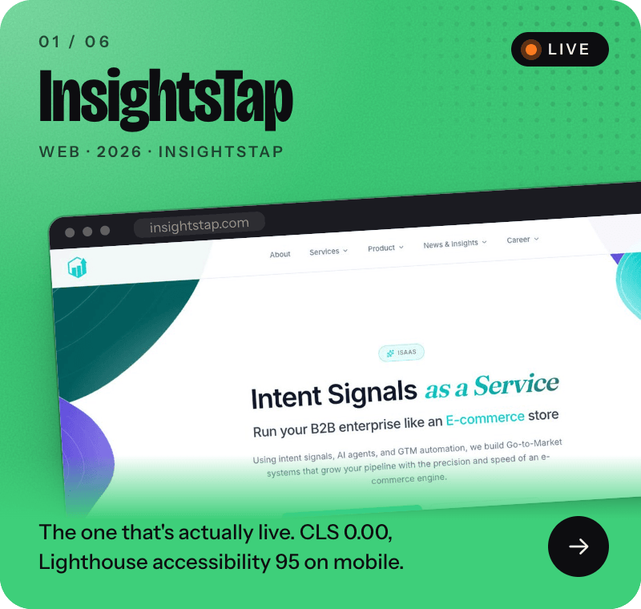
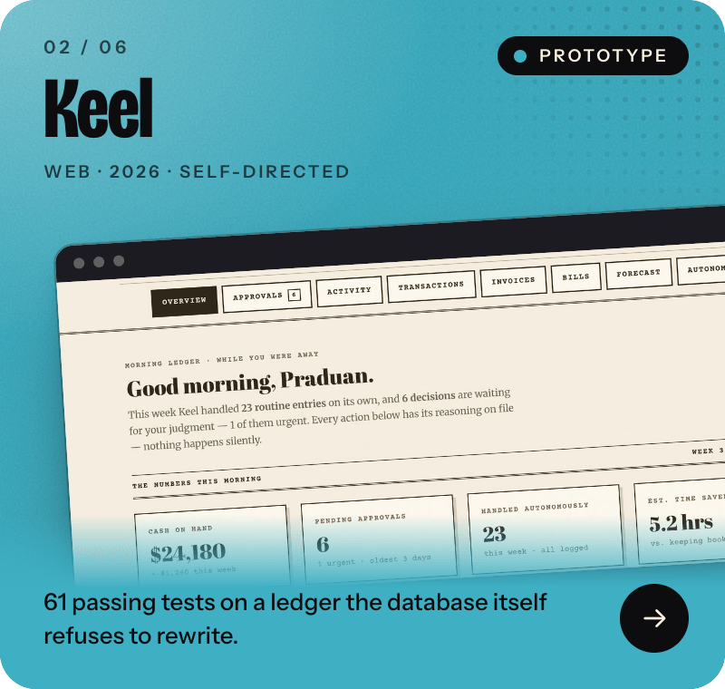
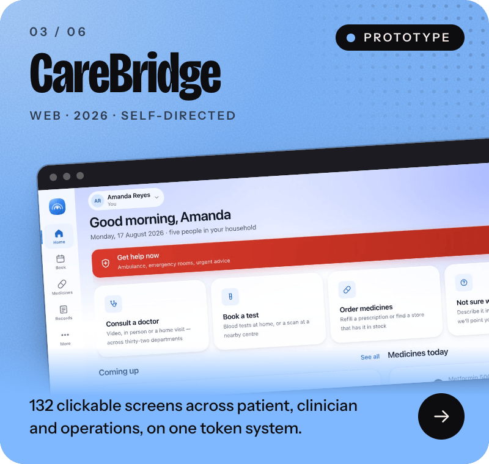
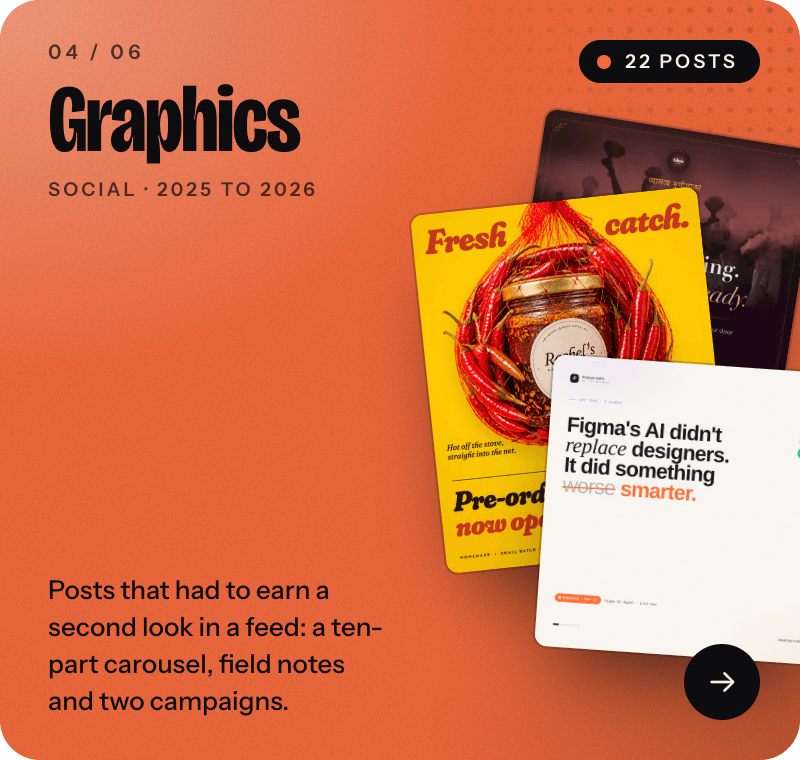
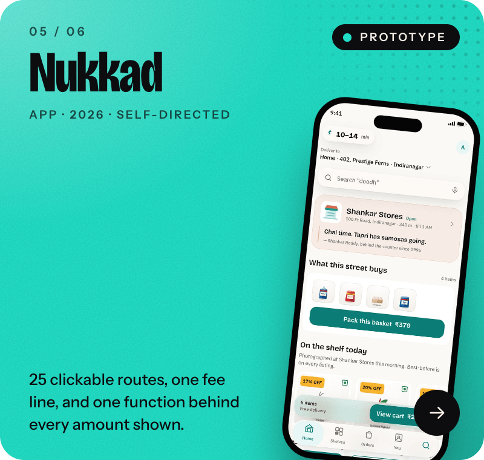
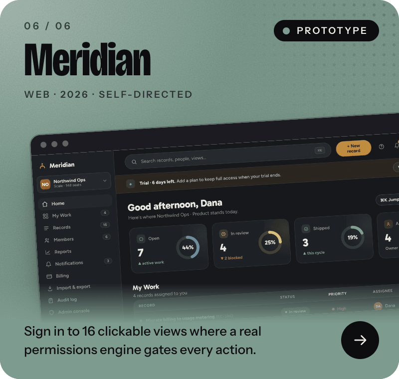
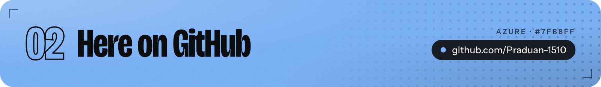
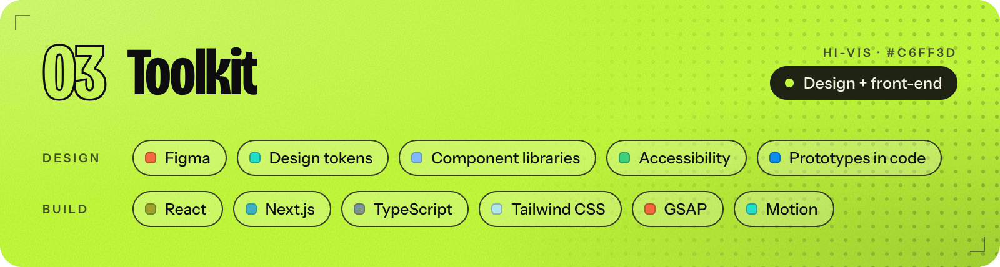

<a href="https://praduansaha.com">
  <picture>
    <source media="(prefers-color-scheme: dark)" srcset="assets/banner-dark.png">
    
  </picture>
</a>

  <a href="https://praduansaha.com"><b>Portfolio</b></a>&nbsp;&nbsp;·&nbsp;&nbsp;<a href="https://praduansaha.com/work">Case studies</a>&nbsp;&nbsp;·&nbsp;&nbsp;<a href="https://praduansaha.com/resume">Résumé</a>&nbsp;&nbsp;·&nbsp;&nbsp;<a href="https://www.linkedin.com/in/praduan-saha-9a8965172/">LinkedIn</a>&nbsp;&nbsp;·&nbsp;&nbsp;<a href="mailto:hey@praduansaha.com">hey@praduansaha.com</a>

I design the kind of software people have to trust without thinking about it: ledgers that can't quietly disagree with themselves, consoles that never show the wrong person the wrong account. I've been doing this since 2019, and right now that means building the front end for a B2B AI go-to-market product by day, and picking apart Indian quick-commerce apps in my spare time to see what they get wrong (there's more than you'd think). If your product's hard part lives in the permissions model rather than the colour palette, we're probably a good match.

  
  

  
  

  
  

Ten case studies in all on [praduansaha.com/work](https://praduansaha.com/work): one live in production, and nine working prototypes you can open and click through, not slideshows.

- **[motion-film](https://github.com/Praduan-1510/motion-film)** · A Claude Code plugin, in development, that renders motion-graphics marketing videos in code: a brand-neutral motion engine, motion-blurred frames, and verified MP4s with a synthesized score.
- **[TrackMeLive](https://github.com/Praduan-1510/TrackMeLive)** · Share where you are, the moment you're on the phone. The functional spec, brand, design system and a click-through prototype for the app.

